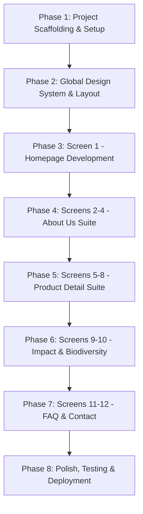

# Young and Dufe — Master Next.js Cloning & Execution Plan
> **Brand Name:** Young and Dufe  
> **Original Reference:** [savannahfruits.com](https://www.savannahfruits.com/)  
> **Tech Stack:** Next.js 15 (App Router), React 19, TypeScript, Tailwind CSS, Lucide React / Swiper / Framer Motion  
> **Asset Status:** 70+ media assets (videos, high-res photos, custom fonts, vector maps, SDG badges) downloaded and organized in `c:/Users/dufee/Documents/younganddufe/public/`

---

## Table of Contents
1. [Project Overview & Brand Evolution](#1-project-overview--brand-evolution)
2. [Downloaded Asset Inventory & Directory Structure](#2-downloaded-asset-inventory--directory-structure)
3. [Architecture & Technology Stack](#3-architecture--technology-stack)
4. [Screen-by-Screen Implementation Blueprints (All 12 Screens)](#4-screen-by-screen-implementation-blueprints)
   - [Screen 1: Homepage (`/`)](#screen-1-homepage-)
   - [Screen 2: Our Story (`/about/our-story`)](#screen-2-our-story-aboutour-story)
   - [Screen 3: Partners (`/about/partners`)](#screen-3-partners-aboutpartners)
   - [Screen 4: Team (`/about/team`)](#screen-4-team-aboutteam)
   - [Screen 5: Shea Butter Product Detail (`/products/shea-butter`)](#screen-5-shea-butter-product-detail-productsshea-butter)
   - [Screen 6: Organic Virgin Coconut Oil (`/products/coconut-oil`)](#screen-6-organic-virgin-coconut-oil-productscoconut-oil)
   - [Screen 7: Cold-Pressed Baobab Oil (`/products/baobab-oil`)](#screen-7-cold-pressed-baobab-oil-productsbaobab-oil)
   - [Screen 8: African Black Soap (`/products/black-soap`)](#screen-8-african-black-soap-productsblack-soap)
   - [Screen 9: Sustainability & Business Model (`/impact/sustainability`)](#screen-9-sustainability--business-model-impactsustainability)
   - [Screen 10: Biodiversity & Ecosystem Conservation (`/impact/biodiversity`)](#screen-10-biodiversity--ecosystem-conservation-impactbiodiversity)
   - [Screen 11: Frequently Asked Questions (`/faq`)](#screen-11-frequently-asked-questions-faq)
   - [Screen 12: Contact & Global Offices (`/contact`)](#screen-12-contact--global-offices-contact)
5. [Global Shared Components & Layout System](#5-global-shared-components--layout-system)
   - [Dual Header Architecture (Transparent vs Solid Tan)](#dual-header-architecture)
   - [Mobile Slide-Over Navigation Drawer](#mobile-slide-over-navigation-drawer)
   - [Global Footer Specification](#global-footer-specification)
   - [Logo Adaptation: "Young and Dufe"](#logo-adaptation-young-and-dufe)
6. [Phased Development Roadmap](#6-phased-development-roadmap)

---

## 1. Project Overview & Brand Evolution

### Brand Concept: Young and Dufe
**Young and Dufe** is an ethical natural ingredients house specializing in hand-crafted African Shea Butter, Organic Virgin Coconut Oil, Cold-Pressed Baobab Oil, and Traditional African Black Soap. 

The website communicates:
- **100% Traceability to Origin:** Direct sourcing from rural women-led cooperatives in West Africa (Ghana, Ivory Coast, Burkina Faso, Mali).
- **Regenerative Supply Chains:** Protecting biodiversity corridors (Ankasa-Tano, Mole, Wechiau) and conserving endangered species (Roloway Monkey, White-naped Mangabey).
- **Modern Sustainable Luxury:** Organic raw beauty ingredients delivered with high-contrast editorial aesthetics.

---

## 2. Downloaded Asset Inventory & Directory Structure

All media assets from the live website have been downloaded into the project's `public/` directory:

```
c:/Users/dufee/Documents/younganddufe/public/
├── fonts/
│   └── bobby-jones-soft.otf          # Artisanal display font
├── sfc.mp4                            # Hero background loop video (54.7 MB)
├── impact-report.mp4                  # "Shea gets greener" background video (1 MB)
├── trace-video.mp4                    # "Trace to source" player video (46.7 MB)
├── forest.jpg                         # Bento grid: $15M scale-up hero photo
├── net-zero-water.jpg                 # Bento grid: Net zero water photo
├── shea-waste.jpg                     # Bento grid: Clean energy shea waste photo
├── women.jpg                          # The Story narrative background photo
├── cards/
│   ├── 1.png                          # Shea Butter packaging PNG (transparent background)
│   ├── 2.png                          # Baobab Oil packaging PNG (transparent background)
│   ├── 3.png                          # Coconut Oil packaging PNG (transparent background)
│   └── 4.png                          # Black Soap packaging PNG (transparent background)
├── products/
│   ├── sheabutter.jpg                 # Shea Butter product card & detail banner
│   ├── sheabutter-whipped.jpg         # Whipped variant
│   ├── baobab-oil.jpg                 # Baobab Oil product card
│   ├── coconut-oil.jpg                # Coconut Oil product card
│   ├── coconut-oil3.jpg               # Secondary coconut photo
│   ├── blacksoap.jpg                  # African Black Soap product card
│   ├── coconutoil/                    # Process & harvesting photos (coconut-1, 2, 3)
│   ├── baobaboil/                     # Baobab harvesting & women photos (baobab-1, 2, 3, 4)
│   └── blacksoap/                     # Traditional saponification photos (blacksoap-1, 2, 3, 4)
├── about/
│   └── about-story.jpg                # 4th-generation women cooperatives portrait
├── biodiversity/
│   ├── hippo.jpg                      # Wechiau Hippo sanctuary photo
│   ├── elephant.jpg                   # Mole National Park elephant photo
│   ├── deer.jpg                       # Wildlife photo
│   ├── monkey.jpg                     # Roloway monkey in canopy
│   ├── monkey-side.jpg                # Close-up Roloway primate
│   ├── tree.jpg                       # Ancient parkland tree
│   ├── agree.jpeg, agreement.jpeg     # CREMA governance documentation
│   ├── cert.jpeg                      # Organic certification inspect
│   ├── eco.jpeg                       # Ecological assessment photo
│   ├── infras.jpeg                    # Green processing center infrastructure
│   └── fund.jpeg                      # Community conservation fund photo
├── data/
│   ├── forest.jpg                     # Demarcated parkland maps
│   ├── women.jpeg                     # Cooperative assembly photo
│   ├── process.jpeg, process.png      # Processing workflow diagrams
│   └── euhub.jpg                      # European distribution hub
├── news/
│   ├── 1.jpg                          # Quarterly report cover
│   ├── 2.jpg                          # Processing facility launch
│   └── 3.jpg                          # Sustainability report cover
└── sdg/
    ├── 1.png ... 18.png               # Official UN Sustainable Development Goal badges
```

---

## 3. Architecture & Technology Stack

### Recommended Next.js 15 App Router Structure

```
c:/Users/dufee/Documents/younganddufe/
├── app/
│   ├── layout.tsx                     # Root layout (fonts, meta, footer)
│   ├── page.tsx                       # Screen 1: Homepage
│   ├── about/
│   │   ├── our-story/page.tsx         # Screen 2: Our Story
│   │   ├── partners/page.tsx          # Screen 3: Partners
│   │   └── team/page.tsx              # Screen 4: Team
│   ├── products/
│   │   ├── shea-butter/page.tsx       # Screen 5: Shea Butter
│   │   ├── coconut-oil/page.tsx       # Screen 6: Coconut Oil
│   │   ├── baobab-oil/page.tsx        # Screen 7: Baobab Oil
│   │   └── black-soap/page.tsx        # Screen 8: Black Soap
│   ├── impact/
│   │   ├── sustainability/page.tsx    # Screen 9: Sustainability
│   │   └── biodiversity/page.tsx      # Screen 10: Biodiversity
│   ├── faq/page.tsx                   # Screen 11: FAQ
│   ├── contact/page.tsx               # Screen 12: Contact Us
│   └── globals.css                    # Tailwind v4 or theme directives
├── components/
│   ├── layout/
│   │   ├── Header.tsx                 # Transparent & solid header variants
│   │   ├── MobileDrawer.tsx           # Full-screen red navigation overlay
│   │   └── Footer.tsx                 # Full-width 4-column footer
│   ├── home/
│   │   ├── HeroVideo.tsx              # Fullscreen video background
│   │   ├── StatCardsGrid.tsx          # 2x2 interactive flip reveal cards
│   │   ├── PartnerMarquee.tsx         # Seamless infinite scrolling banner
│   │   ├── ProductCardsShowcase.tsx   # 4 distinctive colored cards
│   │   ├── SustainabilityAccordion.tsx# 3-item clean pill accordion
│   │   ├── ImpactBanner.tsx           # Video banner with investment tag
│   │   ├── HighlightsBento.tsx        # Asymmetrical 3-card bento grid
│   │   ├── CountryPresense.tsx        # West African vector maps
│   │   ├── TraceToSource.tsx          # Video player + editorial split
│   │   ├── StorySection.tsx           # Narrative copy on photo
│   │   ├── NewsGrid.tsx               # 3-column news cards
│   │   └── SDGGrid.tsx                # 18-tile UN goal badges
│   └── ui/
│       ├── Button.tsx                 # Primary amber, caramel & outline styles
│       ├── BrandLogo.tsx              # SVG logo with "Young and Dufe" text
│       └── Accordion.tsx              # Animated expand/collapse primitive
└── public/                            # Downloaded media assets
```

---

## 4. Screen-by-Screen Implementation Blueprints

---

### Screen 1: Homepage (`/`)
- **Route:** `app/page.tsx`
- **Header State:** **Transparent Overlay** (`absolute top-0 left-0 w-full z-50 py-4`, white inverted logo, white uppercase nav links).

#### Detailed Sections Breakdown:
1. **Hero Section (`#hero`):**
   - Height: `100vh` (`h-screen`).
   - Background Video: `/sfc.mp4` (`autoplay muted loop playsinline object-cover scale-110`).
   - Overlay: Subtle vignette gradient (`after:bg-black/20`).
2. **Impact Metric Statistics (`#stats`):**
   - Background: `bg-brand-accent` (`#F8F2EC`).
   - Left Column: Bold terracotta typography artwork in `fill-brand-red` (`#9D2D20`).
   - Right Column: 2×2 grid of interactive stat cards:
     - Card 1 (`#F1BA40` Amber): `47,554+ Rural Women` -> Hover reveals: *"Directly engaged through women-led cooperatives with self-governance."*
     - Card 2 (`#913729` Terracotta): `4 Regenerative Value Chains` -> Hover reveals: *"Built to protect biodiversity and restore degraded land."*
     - Card 3 (`#99C454` Green): `10% Profit Reinvestment` -> Hover reveals: *"From farm to export, verified through annual lifecycle analysis."*
     - Card 4 (`#C0A47F` Sand): `89% Cut in Firewood Use` -> Hover reveals: *"Replacing traditional fuel with clean shea-waste briquettes."*
3. **Partner Marquee Banner (`#marquee`):**
   - Title: `text-brand-red font-oswald uppercase font-bold text-sm text-center mb-4` ("OUR PARTNERS").
   - Continuous horizontal auto-scrolling logos with pause on hover.
4. **Signature Product Showcase (`#products`):**
   - 4 tall cards (`h-[600px] lg:h-[630px] rounded-2xl p-4 relative overflow-hidden hover:scale-95 duration-300`):
     - **Shea Butter:** Pure Black `#000000`, product bottle top-center (`scale-[1.7]`), bottom claims in `font-bobby`.
     - **Baobab Oil:** Golden Amber `#F5BD41`, bottle rotated 45° bottom-center, top-left title, bottom-right superfruit callout.
     - **Coconut Oil:** Alabaster Cream `#F7F6F4`, bottle bottom-right, conservation story top-left.
     - **African Black Soap:** Terracotta Red `#913729`, product bottom-left, natural cleanser intro top-left.
   - Mobile: Swiper touch carousel with active pill bullet indicator.
5. **Structural Principles of Sustainability (`#about`):**
   - Left: Yellow accent bar (`#FFCC00`) + Brand SVG vector.
   - Right: Title `"OUR STRUCTURAL PRINCIPLES OF SUSTAINABILITY"` + 3 pill accordions (`Environmental Sustainability`, `Social Sustainability`, `Business Sustainability`).
6. **Impact Video Banner (`#impact-report`):**
   - 50vh mobile / 100vh desktop video background (`/impact-report.mp4`) with `bg-black/70` dark overlay.
   - Top-right tag: `"A $4 MILLION MULTI-COUNTRY INVESTMENT IN WOMEN-OWNED GREEN CENTERS"`.
   - Headline: `"SHEA GETS GREENER"` in Oswald 900 (`text-7xl`).
   - CTA: Outlined pill button `"Impact Report"` with rotated arrow icon.
7. **Bento Grid Highlights (`#highlights`):**
   - Asymmetrical 3-card layout:
     - Large 2×2 card: `/forest.jpg` with caption *"A $15 Million Scale Up : Building A Blueprint That Protects 16 Million Women & 8 Million Trees"*.
     - Stacked card 1: `/net-zero-water.jpg` (*Net Zero Fresh Water Footprint*).
     - Stacked card 2: `/shea-waste.jpg` (*Clean Energy Made From Shea Waste*).
8. **Country Presence Section (`#countries`):**
   - Desktop: 4 columns on Terracotta Red `#9D2D20` with white vector boundary maps of **Ghana**, **Ivory Coast**, **Burkina Faso**, and **Mali**.
   - Mobile: Fullscreen vertical snap slider (`h-screen snap-start`).
9. **Trace to Source (`#countries-text`):**
   - Left: Black accent dash + Oswald H2 `"TRACE TO SOURCE"` + narrative copy + golden button `"ACCESS LIVE TRACE"`.
   - Right: Rounded video container playing `/trace-video.mp4`.
10. **The Story (`#story`):**
    - 70vh photo background (`/women.jpg`) with dark overlay.
    - Title `"THE STORY"` + 18-year legacy text + caramel button `"FIND OUT MORE"`.
11. **News & Insights (`#news`):**
    - Centered brown H2 `"NEWS"` + 3 aspect-video cards with gradient overlay + button `"View all news"`.
12. **UN Sustainable Development Goals (`#sdg`):**
    - Title `"SUSTAINABLE GOALS"` + 18 square badges (`grid-cols-3 lg:grid-cols-9`).
13. **Footer:**
    - Full-color Young and Dufe logo, contact details, navigation links, and social icons.

---

### Screen 2: Our Story (`/about/our-story`)
- **Route:** `app/about/our-story/page.tsx`
- **Header State:** **Solid Tan Background** (`bg-[#C6A376]`, white logo, white nav links).

#### Detailed Sections Breakdown:
1. **Hero Blueprint Banner (`#blueprint`):**
   - Background: `bg-brand-accent` (`#F8F2EC`).
   - Title: `text-4xl lg:text-7xl xl:text-8xl font-oswald text-brand-brown tracking-tighter`:
     *"Building A Blueprint That Protects <span class="text-brand-red">16 Million Women</span> & <span class="text-[#2D5016]">8 Million Trees</span>"*.
   - Floating Stats Pill Bar:
     - Glassmorphism pills (`bg-white/60 backdrop-blur px-6 py-3 rounded-full`).
     - Stat 1: **$8M** Annual Revenue
     - Stat 2: **48,000** Rural Women
     - Stat 3: **10%** Profit Reinvestment
2. **Founding Philosophy Copy (`#story-content`):**
   - Max width container (`max-w-4xl`), text in `text-xl text-brand-brown leading-relaxed`.
   - Story of how an impact-first model grew from an idealistic proposal into a multi-country commercial success.
3. **The Leadership Board (`#board`):**
   - Title: `H2: Our Board` (`text-3xl lg:text-5xl font-oswald uppercase text-brand-brown`).
   - 4-column card grid of board members:
     - Card 1: Raphael Gonzalez (Co-Founder)
     - Card 2: Richelieu Dennis (Board Member)
     - Card 3: Sofi Tucker Foundation (Partner)
     - Card 4: Bart Boterman (Co-Founder)
   - Button: Terracotta pill `"Meet Our Team"` linking to `/about/team`.
4. **The Mission Statement (`#mission`):**
   - Background: Deep Forest Green `bg-[#2D5016]` (`py-16 lg:py-32`).
   - Pill badge: Amber dot + white text `"OUR MISSION"`.
   - Typography: Huge Oswald H2 (`text-3xl lg:text-5xl xl:text-6xl text-white`):
     *"To build regenerative business models that ensure that well-intentioned consumption of sustainable ingredients does not disrupt the regenerative ecosystems that have sustained it for centuries."*
5. **18 Years of Impact Journey (`#journey`):**
   - Split layout:
     - Left: Badge `"18 Years of Impact"`, title `"Working Directly With 4th-Generation Rural Women"`, 2 explanatory paragraphs.
     - 3-Stat Color Grid:
       - Purple `#AA8DC2`: **48K** Women
       - Orange `#F28900`: **50+** Cooperatives
       - Burgundy `#80171A`: **5** Countries
     - Right: Photo `/about/about-story.jpg` in a `rounded-3xl` container.
6. **Video Highlights Grid (`#highlights`):**
   - Bento grid with 3 responsive YouTube embedded documentaries on community impact.
7. **Our Products Showcase (`#our-products`):**
   - 4-column grid with square images and hover shadows:
     - Shea Butter (`/products/sheabutter.jpg`)
     - Baobab Oil (`/products/baobab-oil.jpg`)
     - Coconut Oil (`/products/coconutoil.jpg`)
     - African Black Soap (`/products/blacksoap.jpg`)
8. **Digital Traceability Callout (`#traceability`):**
   - Background: Dark Charcoal `bg-[#1A1A1A]`.
   - Title: `"Blockchain-based Digital Traceability"`.
   - Subtitle: *"Building confidence beyond claims. Trace the whole journey of shea from the shelf to the women who produced it."*
   - Interactive QR Code mockup + CTA button `"Trace Your Product"`.

---

### Screen 3: Partners (`/about/partners`)
- **Route:** `app/about/partners/page.tsx`
- **Header State:** **Solid Tan Background** (`bg-[#C6A376]`).

#### Detailed Sections Breakdown:
1. **Hero Header:**
   - Title: `"Strategic & Ecological Partners"` in Oswald font.
   - Subtitle: *"Aligning with global cosmetic leaders, ethical foundations, and community conservation organizations."*
2. **Commercial & Brand Partners Grid:**
   - Cards showcasing major commercial partners (L'Occitane, NOË, Unilever, The Body Shop, Sofi Tucker Foundation, Sundial Brands).
   - Card structure: Clean white card, high-res partner logo, cooperative sourcing region, and years of engagement.
3. **Conservation & Biodiversity Alliances:**
   - Dedicated tier for conservation partners:
     - **WAPCA** (West African Primate Conservation Action)
     - **CREMA** (Community Resource Management Areas)
     - **IUCN** (International Union for Conservation of Nature)
     - **GSA** (Global Shea Alliance)
4. **Partner Inquiry Form / CTA:**
   - Full-width callout: *"Partner With Young and Dufe to Build a Dedicated Regenerative Supply Chain."*
   - Button linking to `/contact`.

---

### Screen 4: Team (`/about/team`)
- **Route:** `app/about/team/page.tsx`
- **Header State:** **Solid Tan Background** (`bg-[#C6A376]`).

#### Detailed Sections Breakdown:
1. **Header Banner:**
   - Background: `bg-brand-accent` (`#F8F2EC`).
   - Title: `H1: Our Team` in Oswald 700 (`text-5xl lg:text-7xl text-brand-brown uppercase tracking-tighter`).
   - Lead paragraph: *"Meet the agronomists, supply chain engineers, cooperative liaisons, and operators driving regenerative value from origin to export."*
2. **Executive & Operational Grid (12 Team Members):**
   - Layout: Responsive grid (`grid-cols-1 md:grid-cols-2 lg:grid-cols-4 gap-8`).
   - Card Styling: `bg-white rounded-2xl overflow-hidden shadow-md hover:shadow-xl transition-all group`.
   - Team Directory:
     1. **Raphael Gonzalez** — Managing Director
     2. **Bart Botterman** — Co-Founder & Director of Operations
     3. **Joel Brenya Attey** — General Finance Manager
     4. **Hubert Courreges** — Commercial & Supply Chain Director
     5. **Linda Bado Zouabet** — Cooperative Liaison Officer
     6. **Gladys A. Atanga** — Quality Assurance & Lab Manager
     7. **Julien Koïkas** — European Distribution Manager
     8. **Obed Rocky Dadzie** — Agronomist & Field Coordinator
     9. **Alhassan Abu Safian** — Processing Center Operations
     10. **Janet Gariba** — Women's Cooperative Coordinator
     11. **Wilhemina Kamasa** — Sourcing & Traceability Lead
     12. **Ruth A. Kwashie** — Administration & Compliance
3. **Cooperative Field Leadership Highlight:**
   - Photo banner celebrating the 50+ cooperative elected women presidents across Tamale, Wa, and Bolgatanga.

---

### Screen 5: Shea Butter Product Detail (`/products/shea-butter`)
- **Route:** `app/products/shea-butter/page.tsx`
- **Header State:** **Solid Tan Background** (`bg-[#C6A376]`).

#### Detailed Sections Breakdown:
1. **Product Hero Banner (`#hero`):**
   - Height: `60vh` mobile / `85vh` desktop.
   - Background: Hero photo (`/products/sheabutter.jpg`) with dark tint.
   - Heading: `"The Story of Hand-crafted Shea Butter"` in Oswald bold uppercase.
2. **Pillars of Sourcing Metric Bar (`#stats`):**
   - 4 stat cards in a horizontal row:
     - `16 Million Women` — The backbone of the African shea belt.
     - `Community Governance` — Cooperatives owning their centers.
     - `Food Systems` — Integrated agroforestry protection.
     - `Biodiversity` — Parkland tree preservation.
3. **Technical & Specification Sheet (`#product-information`):**
   - Clean tabular card layout:
     - **INCI Name:** *Butyrospermum Parkii Butter*
     - **CAS Number:** *91080-23-8*
     - **EINECS Number:** *293-515-7*
     - **REACH Status:** *Exempted*
     - **Shelf Life:** *24 months from manufacture*
     - **Certifications:** *Organic (ECOCERT), Fair For Life, Halal, Kosher*
   - Two Action Buttons:
     - `"Application & Formulations"` (opens technical guide modal)
     - `"Trace to Source"` (scrolls to QR traceability verification)
4. **Direct Sourcing Model Breakdown (`#data`):**
   - Deep dive into the 5 stages of production:
     1. *Reserved Collection Areas* (Forest demarcation)
     2. *Women Cooperatives* (Autonomous governance)
     3. *Eco-Friendly Processing Centers* (Clean briquettes from shea waste)
     4. *EU Hub – Refinery & Distribution* (Halfweg, Netherlands)
     5. *Profit Reinvestment & Value Retention* (Closing the economic loop)
   - Interactive tabs with photos `/data/forest.jpg`, `/data/women.jpeg`, and `/data/process.jpeg`.

---

### Screen 6: Organic Virgin Coconut Oil (`/products/coconut-oil`)
- **Route:** `app/products/coconut-oil/page.tsx`
- **Header State:** **Solid Tan Background** (`bg-[#C6A376]`).

#### Detailed Sections Breakdown:
1. **Hero Banner (`#hero`):**
   - Heading: `"The Story of Organic Virgin Coconut Oil"`.
   - Photo: Coastal groves in Western Ghana and Côte d'Ivoire (`/products/coconut-oil.jpg`).
2. **Primate Habitat & Ecosystem Bar (`#stats`):**
   - Highlights the intersection of coconut groves with rainforest conservation:
     - `Roloway Monkey` (Critically endangered primate habitat protection)
     - `White Naped Mangabey` (Biodiversity indicator species)
     - `Ankasa-Tano CREMA` (Conservation governance)
     - `Zero Clearcutting` (Harvesting only existing agroforestry groves)
3. **Technical Specifications:**
   - **INCI Name:** *Cocos Nucifera Oil*
   - **CAS Number:** *8001-31-8*
   - **Extraction Method:** *Cold-pressed unrefined virgin oil*
   - **Shelf Life:** *24 months*
4. **Conservation-Based Value Chain (`#data`):**
   - 3 narrative cards:
     - *Sourcing Tied to Conservation Landscapes* (Ankasa-Tano CREMA)
     - *Income Linked to Forest Protection* (Conservation contracts)
     - *Conservation Premium for Biodiversity* (Direct fund for primate patrols)
   - Image gallery: `/products/coconutoil/coconut-1.jpeg`, `coconut-2.jpeg`, `coconut-3.jpeg`.

---

### Screen 7: Cold-Pressed Baobab Oil (`/products/baobab-oil`)
- **Route:** `app/products/baobab-oil/page.tsx`
- **Header State:** **Solid Tan Background** (`bg-[#C6A376]`).

#### Detailed Sections Breakdown:
1. **Hero Banner (`#hero`):**
   - Heading: `"The Story of Cold Pressed Baobab Oil"`.
   - Photo: Upper East Region savannah landscape (`/products/baobab-oil.jpg`).
2. **Superfruit Metrics (`#stats`):**
   - `6x More Vitamin C` than oranges.
   - `Antioxidants` rivaling matcha green tea.
   - `Food Sovereignty` for arid dryland regions.
   - `Widows & Orphans Movement` empowerment.
3. **Technical Specifications:**
   - **INCI Name:** *Adansonia Digitata (Baobab) Seed Oil*
   - **CAS Number:** *91745-12-9*
   - **EINECS Number:** *294-680-8*
   - **Shelf Life:** *36 Months*
   - **Comedogenic Rating:** *0 (Non-comedogenic, dry oil feel)*
4. **Partner-Led Sourcing with WOM (`#data`):**
   - Collaboration with the Widows and Orphans Movement in Bolgatanga.
   - How baobab harvesting transforms vulnerable women into structured economic pillars.
   - Photo gallery: `/products/baobaboil/baobab-1.jpeg` through `baobab-4.jpeg`.

---

### Screen 8: African Black Soap (`/products/black-soap`)
- **Route:** `app/products/black-soap/page.tsx`
- **Header State:** **Solid Tan Background** (`bg-[#C6A376]`).

#### Detailed Sections Breakdown:
1. **Hero Banner (`#hero`):**
   - Heading: `"The Story of Traditional African Black Soap"`.
   - Photo: Hand-molded artisan soap bars (`/products/blacksoap.jpg`).
2. **Circular Chemistry Metrics (`#stats`):**
   - `100% Biodegradable`
   - `Zero Synthetic Surfactants`
   - `Local Cocoa Pod Ash` (Alkaline base from agricultural waste)
   - `Handmade in Tamale`
3. **Technical & Ingredient Specifications:**
   - **INCI Breakdown:** *Butyrospermum Parkii (Shea) Butter, Cocos Nucifera (Coconut) Oil, Elaeis Guineensis Kernel Oil, Plant (Theobroma Cacao Husk) Ash, Aqua.*
   - **Shelf Life:** *24 months*
   - **Properties:** *Naturally antibacterial, antifungal, and rich in vitamins A & E.*
4. **Women-Led Sourcing in Tamale (`#data`):**
   - Profiles of the 3 dedicated soap-making cooperatives in Northern Ghana.
   - Traditional kettle boiling and curing process photos: `/products/blacksoap/blacksoap-1.jpeg` to `blacksoap-4.jpeg`.

---

### Screen 9: Sustainability & Business Model (`/impact/sustainability`)
- **Route:** `app/impact/sustainability/page.tsx`
- **Header State:** **Solid Tan Background** (`bg-[#C6A376]`).

#### Detailed Sections Breakdown:
1. **Core Philosophy Hero (`#impact`):**
   - Title: `"This is where the business model matters."` in Oswald bold uppercase.
   - Lead essay: Regenerative value chains as living systems where value circulates and production matches ecosystem pace.
2. **The 4-Pillar Regenerative Architecture (`#business-model`):**
   - **Pillar 1:** *Direct Sourcing (2006 – The Foundation)* — Eliminating predatory middlemen.
   - **Pillar 2:** *Cooperative Framework* — Democratically governed, women-owned legal entities with commercial bank accounts.
   - **Pillar 3:** *Integrated Processing Infrastructure* — Community-owned eco-modern centers utilizing shea waste for energy.
   - **Pillar 4:** *Digital Traceability System* — QR-code batch verification from GPS tree location to shipping container.
3. **Impact Case Studies & Reports (`#news`):**
   - Downloadable PDFs and cards linking to recent independent audits and lifecycle analyses.

---

### Screen 10: Biodiversity & Ecosystem Conservation (`/impact/biodiversity`)
- **Route:** `app/impact/biodiversity/page.tsx`
- **Header State:** **Solid Tan Background** (`bg-[#C6A376]`).

#### Detailed Sections Breakdown:
1. **Hero Statement (`#biodiversity`):**
   - Title: `"Biodiversity Conservation Through Living Value Chains"`
   - Subtitle: *"Keeping forests standing by making conservation economically rational for the communities who live within them."*
2. **The CREMA Framework (`#how-model-protects`):**
   - Complete explanation of Community Resource Management Areas (CREMAs).
   - How market incentives and wildlife protection remain aligned.
3. **Value Chain Deep-Dives (`#value-chains`):**
   - **Shea:** Parkland preservation across Wechiau, Gbele, and Mole landscapes.
   - **Coconut:** Protecting coastal rainforests and primate corridors in Ankasa-Tano.
   - **Baobab:** Restoring dryland agroforestry buffers in the Upper East.
   - **Black Soap:** Zero-waste circular ingredients requiring zero tree felling.
4. **Species & Habitats Protected (`#species-landscapes`):**
   - Visual grid of wildlife supported by Young and Dufe sourcing zones:
     - *Roloway Monkey* (`/biodiversity/monkey.jpg`, `/biodiversity/monkey-side.jpg`)
     - *White-naped Mangabey*
     - *Wechiau Hippos* (`/biodiversity/hippo.jpg`)
     - *Savannah Elephants* (`/biodiversity/elephant.jpg`)
     - *Roan Antelopes & Deer* (`/biodiversity/deer.jpg`)
     - *Heritage Baobab Trees* (`/biodiversity/tree.jpg`)
5. **Partnership Standards (`#customers-partners`):**
   - Summary of EU Deforestation Regulation (EUDR) compliance and third-party verified environmental monitoring.

---

### Screen 11: Frequently Asked Questions (`/faq`)
- **Route:** `app/faq/page.tsx`
- **Header State:** **Solid Tan Background** (`bg-[#C6A376]`).

#### Detailed Sections Breakdown:
1. **Header:**
   - Title: `H1: Frequently Asked Questions` in Oswald 700.
   - Subtitle: *"Everything you need to know about our sourcing, certifications, wholesale ordering, and formulations."*
2. **Categorized Accordion System (`#faq`):**
   - Interactive expandable cards (`border border-black/20 rounded-2xl p-6 bg-white`):
     - **Q1:** *What is the difference between community processed (handcrafted) and industrial shea butter?*
       - Answer: Industrial extraction uses chemical hexane solvents and high heat, destroying unsaponifiables. Handcrafted shea preserves vitamins A, E, and natural triterpenes while providing 100% of value retention to local women.
     - **Q2:** *What is the difference between refined and unrefined shea butter?*
       - Answer: Unrefined retains natural nutty aroma and ivory/yellow tint. Refined is physically steam-filtered for neutral scent in delicate fragrance formulas.
     - **Q3:** *What is the Minimum Order Quantity (MOQ)?*
       - Answer: From 25kg pails for indie formulators to 20ft/40ft full container loads (FCL) for global cosmetic manufacturers.
     - **Q4:** *Can we establish a bespoke or dedicated supply chain for our brand?*
       - Answer: Yes, we build dedicated cooperative sourcing partnerships with custom batch traceability and community impact reporting.
     - **Q5:** *What is Extra Virgin Coconut Oil?*
       - Answer: Wet-milled cold-pressed oil produced without heat or chemicals within 48 hours of nut harvest.
     - **Q6:** *How does buying from Young and Dufe contribute to Biodiversity conservation?*
       - Answer: Sourcing premiums fund CREMA ranger patrols, preventing deforestation in endangered primate corridors.

---

### Screen 12: Contact & Global Offices (`/contact`)
- **Route:** `app/contact/page.tsx`
- **Header State:** **Solid Tan Background** (`bg-[#C6A376]`).

#### Detailed Sections Breakdown:
1. **Header:**
   - Title: `H1: Get in Touch` in Oswald uppercase.
   - Subtitle: *"Inquire about wholesale samples, technical data sheets, bespoke cooperative supply chains, or visit our facilities."*
2. **Global Office Directory (`#form`):**
   - 3-column office grid with maps and contact details:
     - **Origin & Operations Hub:**
       - *Tamale Head Office, P.O. Box TL 20, Tamale, Northern Region, Ghana*
       - Phone: `+233 302737709`
     - **Commercial & Regional Office:**
       - *Accra Office: F276/5A Fourth Dade Walk – Labone, Accra, Ghana*
     - **European Distribution & Logistics:**
       - *Haarlemmerstraatweg 79, 1165MK Halfweg, The Netherlands*
3. **Wholesale Inquiry Form:**
   - Form fields:
     - Full Name / Company Name
     - Business Email & Phone Number
     - Products of Interest (Checkboxes: Shea Butter, Coconut Oil, Baobab Oil, Black Soap)
     - Volume Requirements (<500kg, 1-5 Tons, FCL Containers)
     - Message textarea
   - Submit Button: `bg-brand-red text-white font-oswald text-xl uppercase px-8 py-3 rounded-lg hover:brightness-110`.

---

## 5. Global Shared Components & Layout System

### Dual Header Architecture
The site features **two distinct header presentation modes**:
1. **Transparent Mode (Homepage `/`):**
   - Used only on the homepage to float seamlessly over the autoplay hero video.
   - Styling: `absolute top-0 left-0 w-full z-50 py-4`.
   - Logo: Centered, pure white monochrome (`invert brightness-0`).
   - Links: White text (`text-white hover:text-[#F5BD41] transition-colors`).
2. **Solid Tan Mode (All Inner Pages):**
   - Used on all inner pages (`/about/*`, `/products/*`, `/impact/*`, `/faq`, `/contact`).
   - Styling: `sticky top-0 left-0 w-full z-50 bg-[#C6A376] py-4 shadow-sm`.
   - Logo: Left-aligned, white monochrome.
   - Links: Right-aligned horizontal menu with dropdown popovers.

---

### Mobile Slide-Over Navigation Drawer
- **Trigger:** White 3-bar SVG icon on mobile header (`size-7 fill-white cursor-pointer`).
- **Drawer Overlay:**
  - Full-screen slide-over from right or top (`fixed inset-0 z-50 bg-[#9D2D20] text-white p-6 overflow-y-auto`).
  - Top bar with Young and Dufe white logo and `✕` close button.
  - Large vertical Oswald typography (`text-3xl uppercase font-bold tracking-tight space-y-6`).
  - Accordion dropdowns for sub-pages with animated `+` toggle.

---

### Global Footer Specification
- **Background:** Clean White `#FFFFFF` (`py-12 lg:py-16 px-4 lg:px-12 border-t border-gray-100`).
- **Column 1:**
  - Full-color brand logo (`size-32 lg:size-40`).
  - Phone: `+233 302737709`
  - Address: *Tamale, Northern Region, Ghana*
- **Column 2 (Navigation):**
  - Title: `Internal Links` (Oswald H3 in `#775024`).
  - Links: *Our Story, Sustainability, Biodiversity, FAQ, Contact Us*
- **Column 3 (Legal):**
  - Links: *Terms of Trade, Privacy Policy, ECOCERT Certifications*
- **Column 4 (Socials):**
  - Title: `Connect`
  - Black vector icons: Facebook, LinkedIn, YouTube, Instagram.

---

### Logo Adaptation: "Young and Dufe"

In the original SVG emblem, the roots of the tree spell out *"THE SAVANNAH FRUITS COMPANY"*. For our build:
1. **The Emblem:** Preserve the leafy canopy (`#8BC832`) and graceful female silhouette tree trunk (`#7E4E18`).
2. **The Wordmark:** Update the typography in the root base and wordmark to:
   - **`YOUNG AND DUFE`**
   - Subtitle: *ETHICAL BOTANICALS & HANDCRAFTED OILS*
3. **SVG Implementation:** Create a responsive `<BrandLogo variant="color | white" />` component with clean vector paths.

---

## 6. Phased Development Roadmap

When you are ready to build the application, this roadmap outlines the execution sequence:



### Phase Breakdown

1. **Phase 1: Project Scaffolding & Setup**
   - Initialize Next.js 15 project with TypeScript & Tailwind CSS in `c:/Users/dufee/Documents/younganddufe`.
   - Setup custom fonts (`Oswald`, `Outfit`, `Bobby Jones Soft` via `next/font/local` and `next/font/google`).
   - Configure Tailwind color tokens (`brand-accent`, `brand-red`, `brand-brown`, `brand-tan`, `brand-green`, `brand-amber`).

2. **Phase 2: Layout & Navigation System**
   - Build dual-mode `<Header />` component (transparent vs solid tan).
   - Build responsive `<MobileDrawer />` slide-over navigation.
   - Build global `<Footer />` component.
   - Create vector `<BrandLogo />` component adapted for "Young and Dufe".

3. **Phase 3: Screen 1 — The Homepage (`/`)**
   - Implement hero video with background loop.
   - Build 2x2 interactive hover-flip stat cards with smooth state transitions.
   - Implement infinite marquee partner banner.
   - Construct the 4 signature colored product cards.
   - Build sustainability principles accordion.
   - Implement impact video banner and highlights bento grid.
   - Build West Africa vector maps section.
   - Implement trace-to-source split player, story photo section, news cards, and 18 SDG tiles.

4. **Phase 4: Screens 2–4 — The About Suite**
   - Build `/about/our-story` (blueprint stats, leadership board, mission, 18-year journey).
   - Build `/about/partners` (commercial, foundation, and conservation partner grids).
   - Build `/about/team` (12-member leadership directory).

5. **Phase 5: Screens 5–8 — Product Detail Pages**
   - Build `/products/shea-butter`, `/products/coconut-oil`, `/products/baobab-oil`, and `/products/black-soap`.
   - Reusable template with product hero, technical INCI specifications, application modal, and sourcing narrative.

6. **Phase 6: Screens 9–10 — Impact & Biodiversity Suite**
   - Build `/impact/sustainability` (regenerative value chain architecture).
   - Build `/impact/biodiversity` (CREMA framework, wildlife habitat photos, species conservation).

7. **Phase 7: Screens 11–12 — FAQ & Contact**
   - Build `/faq` with animated question accordions.
   - Build `/contact` with office directory, interactive maps, and wholesale inquiry form.

8. **Phase 8: Polish, Verification & Performance Optimization**
   - Verify all 70+ local media assets load smoothly.
   - Verify responsive behavior across Mobile (375px), Tablet (768px), Laptop (1024px), and Desktop (1440px).
   - Optimize bundle size, video streaming, and image loading with `next/image` and `next/video`.
